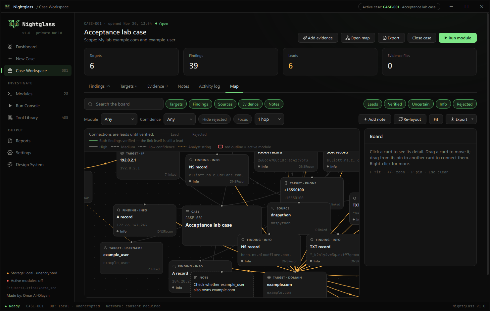
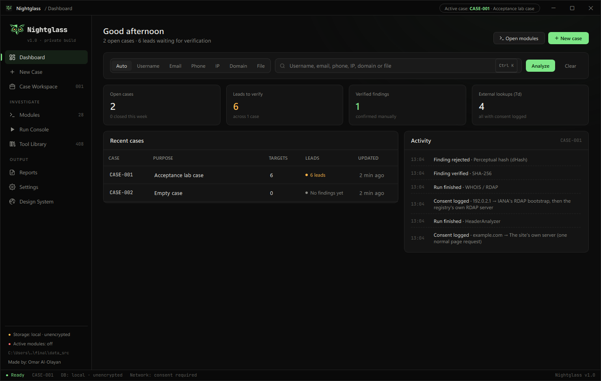
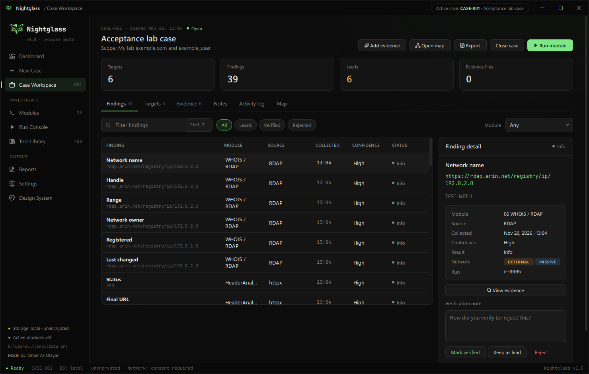
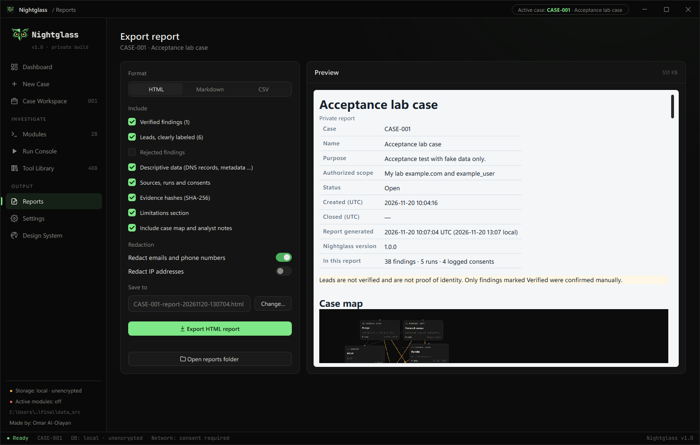
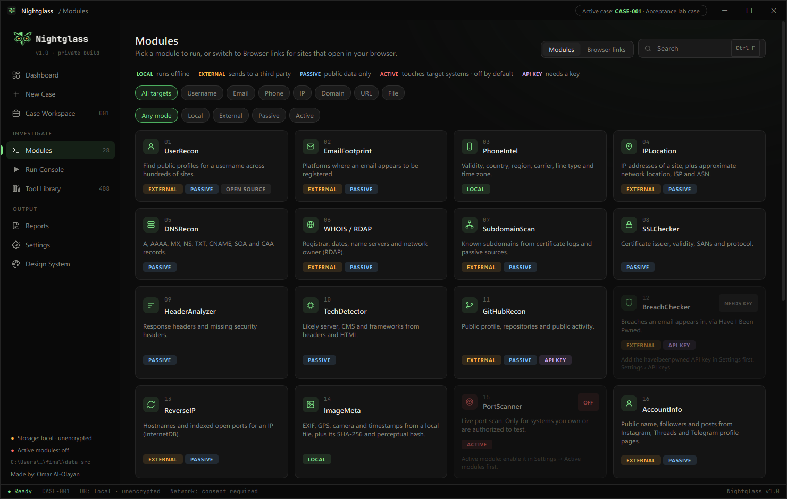
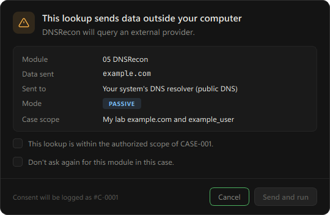

# Nightglass

A Windows desktop OSINT workbench (Python 3.11+, PySide6). Nightglass:

- organizes free and open-source OSINT tools (a catalog of 400+);
- runs 28 built-in lookup modules safely;
- keeps everything in local cases;
- maps each case on an investigation board;
- exports reports with hashes and redaction.



| Dashboard | Findings | Reports |
|---|---|---|
|  |  |  |
| **Modules** | **Consent before any external lookup** | |
|  |  | |

Screenshots use fake data only (`example.com`, `192.0.2.1`, `example_user`).

> **Responsible use.** Nightglass is for lawful research on yourself, your own organization or targets you
> are authorized to investigate. Results are leads, not proof of identity. Respect each service's terms
> of use and your local laws.

`docs/PROJECT_RULES.md` holds the engineering rules and design tokens.

## Run from source

```powershell
python -m venv .venv
.venv\Scripts\python -m pip install -e ".[dev]"
.venv\Scripts\python -m app
```

Case data lives in `cases\` next to the app (git-ignored). Set `NIGHTGLASS_DATA_DIR` to use another folder.

## Build the Windows app (local only)

```powershell
.venv\Scripts\python -m pip install pyinstaller
.venv\Scripts\python scripts\build.py
dist\Nightglass\Nightglass.exe --self-check report.json   # optional: verify the build
```

`dist\Nightglass\` contains `Nightglass.exe` plus `tools\` (editable catalog), `bin\` (pinned
ExifTool) and an empty `envs\`. Heavy tools are never bundled into the exe. Don't attach the build
to any public page.

To install it for yourself:

```powershell
.venv\Scripts\python scripts\install.py
```

This copies the build and the tool environments in `envs\` to `%LOCALAPPDATA%\Programs\Nightglass`
and adds Desktop and Start menu shortcuts. The installed app keeps its cases in that folder, not on
the Desktop, which OneDrive may sync. Reinstalling never touches the installed `cases\`.

## Optional tools

| Tool | Used by | Install |
|---|---|---|
| Sherlock | 01 UserRecon | `python -m venv envs\sherlock` then `envs\sherlock\Scripts\python -m pip install sherlock-project` |
| ExifTool 13.60 | 14 ImageMeta | `exiftool-13.60_64.zip` from exiftool.org: `exiftool(-k).exe` → `bin\exiftool.exe`, plus `exiftool_files\`. The SHA-256 is pinned in `tools\exiftool.yaml`; another version is refused until the pin is updated. |
| theHarvester | 07 SubdomainScan | `python -m venv envs\theharvester`, `git clone --depth 1 --branch 4.6.0 https://github.com/laramies/theHarvester envs\theharvester\app`, `envs\theharvester\Scripts\python -m pip install envs\theharvester\app` |
| SpiderFoot | 07 SubdomainScan | `python -m venv envs\spiderfoot`, `git clone --depth 1 https://github.com/smicallef/spiderfoot envs\spiderfoot\app`, `envs\spiderfoot\Scripts\python -m pip install -r envs\spiderfoot\app\requirements.txt` |
| Blackbird usernames | 01 UserRecon | Same install as Blackbird, plus `wmn-data.json` from the WhatsMyName project in `envs\blackbird\app\data` |
| social-analyzer | 01 UserRecon | `python -m venv envs\social_analyzer`, `envs\social_analyzer\Scripts\python -m pip install social-analyzer` |
| wafw00f | 24 WafDetect (active) | `python -m venv envs\wafw00f`, `envs\wafw00f\Scripts\python -m pip install wafw00f` |
| dnsrecon | 25 ZoneTransfer (active) | `python -m venv envs\dnsrecon`, `envs\dnsrecon\Scripts\python -m pip install dnsrecon` |
| dnstwist | 19 LookalikeDomains | `python -m venv envs\dnstwist`, `envs\dnstwist\Scripts\python -m pip install dnstwist dnspython` |
| yt-dlp | 21 VideoInfo | `python -m venv envs\ytdlp`, `envs\ytdlp\Scripts\python -m pip install yt-dlp` (without curl_cffi) |
| Blackbird | 02 EmailFootprint | Not on PyPI. `git clone https://github.com/p1ngul1n0/blackbird envs\blackbird\app`, `python -m venv envs\blackbird`, `envs\blackbird\Scripts\python -m pip install -r envs\blackbird\app\requirements.txt`. Never run it with `--ai`. |
| ignorant | 26 PhoneRegistration (active) | `python -m venv envs\ignorant`, `envs\ignorant\Scripts\python -m pip install ignorant` |
| Osintgram 2.0 | 28 Osintgram (your Instagram login) | `git clone https://github.com/Datalux/Osintgram envs\osintgram\app`, `python -m venv envs\osintgram`, `envs\osintgram\Scripts\python -m pip install -r envs\osintgram\app\requirements.txt`. Then Settings → API keys → Instagram account. |

**Tool Library → Reload catalog** and **Settings → Tool environments → Check** show what is installed.

## API keys (optional)

Settings → API keys. Keys are stored in Windows Credential Manager, never in files, logs or reports.

- Have I Been Pwned: required for 12 BreachChecker (paid key).
- ipinfo: optional; raises the limits for 04 IPLocation.
- GitHub token: optional; raises the rate limit for 11 GitHubRecon.
- Instagram account: required for 28 Osintgram. Use a secondary account of your own: Instagram may
  block or ban it. The login is written to `config\credentials.ini` inside the run folder only for the
  run and deleted with any session or cookie file when the run ends. Osintgram runs only target-focused
  commands (info, addrs, captions, hashtags, mediatype, tagged, wtagged, likes, comments); follower and
  following lists and their emails or phone numbers are never collected.

27 InstagramPage reads a public profile page without a login. When Instagram shows a login wall the run
fails and says so. 14 ImageMeta also stores a perceptual hash (`dhash:<16 hex>`) so that resized copies of a
picture can be matched.

## Case Map (investigation board)

Every case has a **Map** tab (or **Open map** in the case header): a board of pinned cards for the case,
its targets, findings, sources and evidence, joined by strings. It is built from what the case already
holds; it never collects anything new, and it updates by itself when a run adds findings.

- **Cards** show type, title, value and status. The pin colour is the status: amber lead, green
  verified, blue uncertain, dim rejected. Findings from active modules get a red outline.
- **Strings** run target → finding ("found by <module>"), finding → source and finding → evidence, and
  between findings that share a value: same username, email, domain, IP, URL or image (SHA-256 or dHash).
  Solid, dashed and dotted lines mean high, medium and low confidence. Shared platform hosts
  (github.com, x.com, …) never link two people. **Connections are leads until verified.**
- **Your own notes:** add sticky notes, and drag from a card's pin to another card to add a labelled
  analyst string. Analyst strings are always shown as leads.
- **Working the board:** pin cards in place, use Focus (1–2 hops), filter by type, status, module or
  confidence, search, hide rejected, re-layout and fit. Click a card to verify, keep or reject it from
  the side panel.
- **Saving:** positions, notes and strings are saved per case, in the database (encrypted with it).
- **Export** the board as PNG or SVG. HTML and Markdown reports include it, with an "Analyst notes and
  links" section; redaction applies, and evidence thumbnails never leave the app.

Shortcuts: Ctrl+K quick lookup, Ctrl+N new case, Ctrl+F search, Ctrl+1–9 screens; on the board F fit,
+/− zoom, P pin, Delete remove a note or string, Esc clear.

## Reports

HTML, Markdown and CSV. They contain:

- the case header, targets, findings grouped by status (every unverified row says so), the sources
  and runs, the consents and the evidence (file name and SHA-256, never the local path);
- the case map, a limitations section that lists failed runs, and a `<report>.sha256` file next to
  the report;
- redacted values in every section when redaction is on. CSV cells are protected against
  spreadsheet formula injection.

## How it keeps you safe

- **No shell, ever.** Tools run via QProcess with a fixed argument list from their manifest. Targets
  are validated by type and passed as one whole argument.
- **Every run** has a timeout, an output limit, its own folder (`cases\CASE-xxx\runs\r-0001`) and a log.
- **Consent first.** Any module that isn't purely local shows exactly what is sent and to whom.
  Every consent is logged. Remembering consent works per case and module, never for active modules.
- **Active modules are off by default** (port scan, phone app-registration check, WafDetect, ZoneTransfer; Holehe). Each run needs the
  Settings switch, the case to allow active lookups, the target named in the authorized scope,
  and a fresh consent with an ownership confirmation.
- **Results are leads** until you verify them. Descriptive data (DNS records, metadata) is marked
  Info. Reports keep verified findings and leads apart and include a limitations section.
- **Retention.** Closed cases are deleted with their folders after the configured period (default 90 days).
- **Secrets.** A gitleaks pre-commit hook blocks commits with secrets. After a fresh clone:
  `git config core.hooksPath .githooks` and `winget install Gitleaks.Gitleaks`.

## Tests

```powershell
.venv\Scripts\python -m pytest
```

All fixtures use fake data only (`example_user`, `example.com`, `192.0.2.0/24`, `203.0.113.0/24`, `+1 555`).
Network modules are tested with mocked HTTP and DNS; nothing is sent during tests.

## Known limitations

- Database encryption is Nightglass's own (AES-256-GCM, scrypt key from the master password) rather than SQLCipher. Turn it on in Settings → Privacy & storage. **A forgotten password can't be recovered.** The database is decrypted only in memory; a plain database written before encryption was turned on is overwritten and deleted, but SSD wear-levelling can keep old blocks, so BitLocker is still recommended.
- Evidence, reports and run logs can be encrypted with Windows EFS (Settings). Back up your EFS certificate.
- Arabic covers the fixed interface text (navigation, headers, buttons, labels). Values and tool output stay as collected.
- Amass is a catalog entry only. dnstwist and social-analyzer print results only at the end, so a
  timeout keeps nothing from them.
- Osintgram depends on Instagram accepting the login (2FA and security checks make the run fail with a
  message). It has been tested with fixtures only, never with a real account.
- On very large boards (500+ cards) a few cards can overlap after auto-layout; drag or pin them.
- Licenses marked "verify" in the library haven't been checked against the official sources yet.
